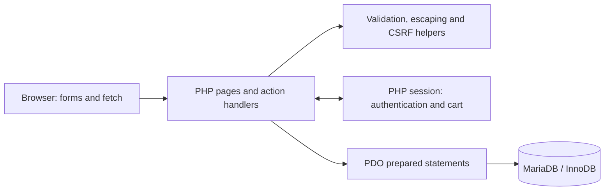
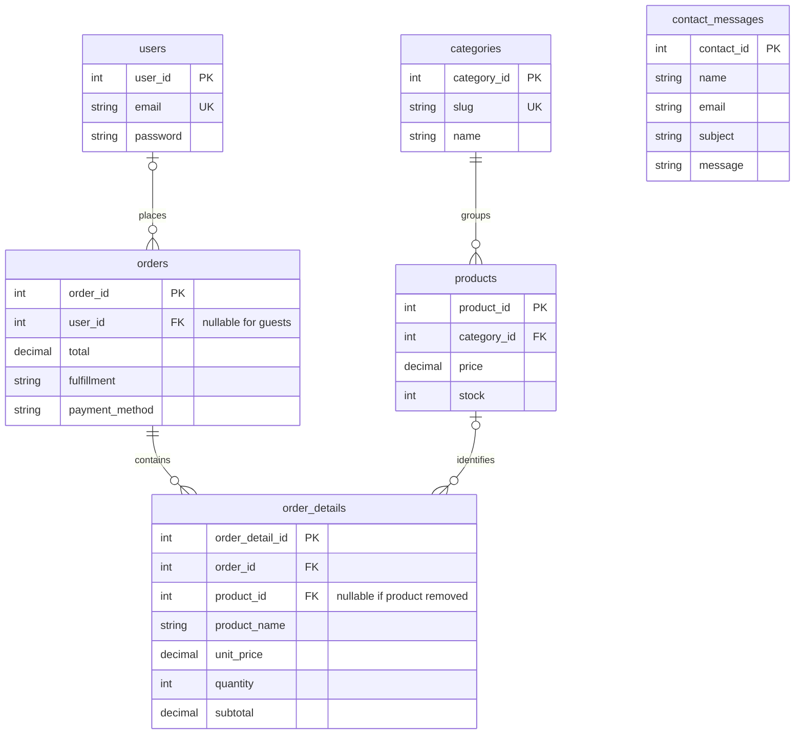

# MCKL Mart
### PHP & MySQL E-Commerce Web Application

[](https://github.com/tayyab-hub/MCKL-Mart/actions/workflows/ci.yml)

**Developed by Muhammad Tayyab** · Individual Diploma in Computer Science Web Computing project

**Live Demo:** [mcklmart.site.je](https://mcklmart.site.je/)

**Source Code:** [tayyab-hub/MCKL-Mart](https://github.com/tayyab-hub/MCKL-Mart)

A convenience-store demonstration hosted on InfinityFree and runnable locally. Built with PHP, PDO and MariaDB, it takes a visitor from product discovery to a simulated database-backed order, demonstrating authentication, session carts, server-side validation and transactional stock handling.

> **Academic demonstration only.** This project is not operated, sponsored or endorsed by Methodist College Kuala Lumpur. Products, payments and fulfillment are simulated. Use fictional information and a temporary password only. No real charge, delivery or support email is connected.

The hardened demo was deployed on **15 October 2026**. All ten uploaded runtime files matched the reviewed source, and **21 live checks passed**, covering cookies, headers, CSRF rejection, private-path protection and login throttling. HTTP-to-HTTPS redirection was also verified. See the [deployment review](docs/LIVE_DEPLOYMENT_REVIEW.md) for the evidence and testing limits.

[Features](#features) · [Architecture](#system-architecture) · [Installation](#installation) · [Testing](#testing) · [Limitations](#known-limitations)

## Screenshot gallery

Actual browser captures of this application, using disposable databases and fictional customer details. These eight captures document the original reviewed interface before the additional public-demo restrictions. Product images were generated by the author using ChatGPT Image Generation for coursework/portfolio use; they are not photographs of real merchandise. See [asset provenance](docs/ASSETS.md) and [capture details](docs/SCREENSHOTS.md).


| Product discovery | Shopping cart |
| --- | --- |
|  |  |
| **Product details** | **Account order history** |
|  |  |

<details>
<summary>Checkout, mobile and tablet views</summary>


</details>

## Project overview

Developed for an individual Web Computing assignment at Methodist College Kuala Lumpur, Malaysia, MCKL Mart models a small student convenience store. The project connects a responsive interface to a six-table relational database without a frontend framework.

The engineering focus is the full request lifecycle: validate submitted fields, authenticate the session, authorize access, query through prepared statements, commit a consistent order and return useful feedback. The repository includes safe sample data and automated checks so another developer can reproduce those workflows locally.

## Features

| Area | Implemented behavior |
| --- | --- |
| Catalogue | 17 sample products in Drinks, Snacks, Meals and Essentials; keyword search, category filters, product pages and stock indicators. |
| Accounts | Registration, hashed passwords, login/logout, session rotation and a shared account panel. |
| Cart | Session-based add, update, remove and clear actions; current-stock checks and a 99-item per-product cap. |
| Checkout | Guest or account ordering; pickup slots or a delivery address; cash, card or e-wallet **selection only**. |
| Order processing | Server-calculated prices, product row locks, conditional inventory deduction, order lines and transaction rollback. |
| Order history | Account-owned orders and details; a guest can link their latest order by registering in the same session with its matching email. |
| Contact | Validated messages saved to the local database with confirmation; no email transmission. |
| Interface | Responsive layouts, keyboard-accessible controls, dialog focus handling, visible focus and a pausable slideshow. |
| Public-demo safeguards | Generated sample identities, fixed personal fields and sample messages; persistent submission limits, bounded records and small POST bodies. Deployed with the verification scope documented below. |

There is no admin product-management dashboard, payment gateway, courier integration or password-recovery service.

## Technology stack

| Layer | Technology |
| --- | --- |
| Server | PHP 8.2+, PDO MySQL, `mbstring` |
| Database | MariaDB 10.4+ with InnoDB; verified locally on 10.4.32 |
| Browser | HTML5, CSS3, vanilla JavaScript |
| Hosting | InfinityFree public demo; XAMPP / Apache on Windows for local development |
| Verification | PHP CLI and cURL, Node.js, browser checks, GitHub Actions workflow |
| Dependencies | No Composer or npm application dependencies; optional Google Fonts with a system-font fallback |

PDO's MySQL driver is used. MySQL server compatibility has not been independently verified; the tested database engine is MariaDB.

## System architecture



- **Authentication:** registration hashes the password; login verifies it and rotates the session ID. Protected pages filter orders by the authenticated user ID.
- **Cart:** the session stores product IDs and quantities. Display and checkout re-read catalogue prices and availability from MariaDB.
- **Checkout:** validate input, begin a transaction, lock products in ID order, check stock, write the order and its lines, deduct inventory and commit. Any failure rolls back the transaction; successful submission redirects to a confirmation.
- **Configuration:** environment variables or an ignored local PHP file supply the connection. Credentials are never part of the public example.

| Path | Responsibility |
| --- | --- |
| Root PHP pages | Catalogue, accounts, cart, checkout, history and contact |
| `includes/` | Bootstrap, database connection, shared helpers and layout |
| `database/` | Schema and safe catalogue seed |
| `Products/` | Author-supplied AI-generated product illustrations |
| `assets/` | Original project-logo vector source |
| `tests/` | Helpers, static checks, disposable database/HTTP tests and rendered JavaScript parsing |
| `docs/` | Test evidence, repair history, asset provenance and screenshots |
| `.github/workflows/ci.yml` | Linux syntax, helper, static and disposable MariaDB checks |

## Database design



All six tables use InnoDB. Four foreign keys connect catalogue, accounts and orders; contact messages are independent. Order lines retain purchased names and prices. Unique keys protect account emails and category slugs. Fresh imports include nonnegative price/stock and order-line arithmetic constraints. See [database notes](database/README.md).

## Installation

1. Install XAMPP with **PHP 8.2+ and MariaDB**. Place this repository at `C:\xampp\htdocs\MCKL-Mart` and start **Apache** and **MySQL** in XAMPP.
2. Confirm `pdo_mysql` and `mbstring` are enabled in `C:\xampp\php\php.ini`; restart Apache after changes.
3. **For a new installation only**, create an empty database named `mckl_mart_portfolio` with `utf8mb4_unicode_ci` in [phpMyAdmin](http://localhost/phpmyadmin/). Import `database/setup.sql`, or `schema.sql` followed by `seed.sql`. Skip this step for an existing installation; never re-import over coursework or existing customer data.
4. Create `mckl_mart_app` at `localhost` in phpMyAdmin, choosing its password privately. Give it only the storefront permissions:

   ```sql
   -- Create the account privately in phpMyAdmin before granting access.
   GRANT SELECT, INSERT, UPDATE, DELETE
     ON mckl_mart_portfolio.* TO 'mckl_mart_app'@'localhost';
   ```

5. Copy `includes/config.example.php` to `includes/config.local.php` **only if the local file does not already exist**. Replace the password placeholder privately and save. The file must return a PHP array; preserve quoting and escape `'` as `\'` and `\` as `\\` in single-quoted values.
6. Open **[http://localhost/MCKL-Mart/](http://localhost/MCKL-Mart/)**. Register a fictional account or try guest checkout.

The public example contains only `localhost:3306`, the database/account names and a placeholder. Keep the real local configuration off Git. Use the restricted application account, not the database administrator.

Environment alternatives: `MCKL_DB_HOST`, `MCKL_DB_PORT`, `MCKL_DB_NAME`, `MCKL_DB_USER`, `MCKL_DB_PASSWORD`. They must be available to the **Apache process** and take precedence over the local file. Variables in an unrelated terminal do not configure a running Apache service.

| Problem | Check |
| --- | --- |
| “MCKL Mart has not been configured” | Exact local filename, saved password and removal of the placeholder. |
| “The demo database is unavailable” | MariaDB service, host/port, database name, account password and permissions. |
| HTTP 500 after server setup | Apache error log, `mod_rewrite` and permission for `.htaccess` overrides. |
| Missing pictures on Linux | Preserve filename case and spaces; run `tests/static_test.php`. |

## Deployment

The public demo uses InfinityFree free hosting, PHP and Apache-compatible rules with the application's MySQL-compatible database connection. MariaDB is the independently tested local and CI engine; the hosted database version was not inspected. The reviewed runtime files were deployed through an authenticated WinSCP session into `/htdocs`, with nine original files backed up and all ten uploads verified by size and SHA-256 readback. GitHub Actions tests the source; it does not deploy the website. The live database configuration stays on the host and is never included in Git or the upload bundle. Free hosting has availability, traffic, storage and execution limits; this is an academic demonstration, not a production store or uptime commitment.

Public demo mode is enabled by default. It supplies generated `demo-…@example.test` identities and fixed names, phone/address fields and contact-message text, so visitors can demonstrate the workflow without providing real contact details. Choose a temporary password and save the generated email for later login. Standard coursework validation remains available only through the trusted server setting `MCKL_DEMO_MODE=0`; leave that override unset on the public host.

The deployed release caps login, signup, contact and checkout attempts independently of browser sessions. Total records are capped at 200 accounts, 500 orders, 5,000 order lines and 200 contact messages. Full or unavailable protection storage pauses submissions while allowing browsing. There is no automatic deletion, cron requirement or schema migration. The [operations guide](docs/DEMO_OPERATIONS.md) explains limits, shared-network trade-offs and manual cleanup.

HTTP requests to the public host redirect to the same HTTPS path and query using a fixed-host 302 rule. HTTPS certificate validation and the absence of redirect loops were verified; the session cookie carried `Secure`, `HttpOnly` and `SameSite=Lax`. Seven private-path markers were denied while a public control was accessible. All eight temporary markers were then removed. The [release checklist](docs/DEPLOYMENT.md) and [deployment review](docs/LIVE_DEPLOYMENT_REVIEW.md) record the process, rollback procedure and verification scope. Private configuration and production database records were untouched.

## Testing

Local verification on **15 October 2026** passed **162 integration checks** (116 original regression checks plus 46 demo-protection checks), **32 limiter/privacy checks**, **21 helper checks** and **33 static checks**. All 25 tracked PHP files, three JavaScript sources, four external/rendered script blocks and the Actions workflow passed syntax validation. The integration suite imports both database setup paths and exercises concurrent checkout, concurrent registration, authorization, CSRF, validation, storage caps and failure rollback. These results are local evidence, not a coverage or production-security claim.

```powershell
& C:\xampp\php\php.exe tests/helpers_test.php
& C:\xampp\php\php.exe tests/static_test.php
& C:\xampp\php\php.exe tests/demo_test.php
node --check script.js
```

The integration runner requires an explicitly configured local test administrator. It creates two random test databases, starts loopback PHP servers and drops only the databases it created. **It does not reset the portfolio database.** See [full test commands and evidence](docs/TESTING.md), [publication review](docs/PUBLICATION_REVIEW.md) and the [historical repair report](docs/REPAIR_REPORT.md).

The [GitHub Actions workflow](.github/workflows/ci.yml) passed both hosted jobs for the published baseline on 14 October 2026: PHP/JavaScript syntax, 21 helper checks, 33 static checks and 116 MariaDB integration checks. The [verified published run](https://github.com/tayyab-hub/MCKL-Mart/actions/runs/38567544084) records that result; the badge above tracks `main`. All eight screenshots and both Mermaid diagrams were verified on the published README.

The workflow also runs the new limiter/privacy and extended integration suites on pushes and pull requests. Use the pull request's **Checks** tab for the result on its exact revision; the badge above continues to track `main`. See [testing instructions](docs/TESTING.md) and the [deployment review](docs/LIVE_DEPLOYMENT_REVIEW.md) for the separate local and live evidence.

## Security features

- Native PDO prepared statements; shared server-side input validation and escaped HTML output.
- `password_hash` / `password_verify`; validation limits bcrypt input to 72 bytes.
- Session-bound CSRF tokens and POST-only cart/logout mutations.
- Dedicated session cookie, strict mode, HttpOnly, SameSite=Lax and Secure on HTTPS or the known public hostname; session rotation on authentication. All three cookie flags were observed on the live HTTPS response.
- Exact local redirect allowlist, owner-restricted history/confirmations and generic browser error responses.
- Transactional checkout with row locking, inventory checks and rollback.
- Public-demo submission limits use a locked, bounded file shared by PHP workers, with hashed client/account identifiers and fail-closed behavior. Record-cap checks hold the same lock through database writes.
- Apache rules deny private directories, dotfiles, SQL exports, backups and directory listing; personal responses use `Cache-Control: no-store`.

These are implemented and regression-tested controls. No penetration-test certification or production-security guarantee is claimed.

## Known limitations

- Payments and pickup/delivery are simulated; contact messages stay in MariaDB.
- No email verification, password reset, admin dashboard or order-status management UI. Generated demo accounts should use a unique temporary password.
- Shared networks/proxies can share a rate limit; distributed abuse, deliberate quota exhaustion and hosting resource exhaustion are not eliminated.
- Signup, successful account login, completed orders and contact writes were regression-tested locally, not independently repeated against production after deployment. Only login throttling was exercised live; other quotas, caps and concurrency retain local test coverage. Hosting-level PHP startup error settings remain unverified.
- Demo orders reduce sample inventory, and capped records require deliberate owner review; there is no automatic cleanup or restocking. HSTS is not enabled.
- Other database engines, broad cross-browser/device coverage, accessibility certification and load testing remain unverified.
- Existing installations do not automatically receive the new schema CHECK constraints; a reviewed migration is needed. Do not re-import to upgrade.
- AI product art is fictional. The author confirms generating all 17 images using ChatGPT Image Generation for this assignment; exact model/version and prompts are not recorded. See [asset review](docs/ASSETS.md).
- InfinityFree runs the PHP/database demo; GitHub hosts the source. Free-hosting availability and resource limits still apply. Existing stored records are not scrubbed by this release and need separate owner review if they contain real data.

## Future improvements

Add an authorized admin interface, pagination and account recovery; expand browser/accessibility tests; introduce migrations and deployment monitoring. Real payment or fulfillment integrations would require separate design and verification.

## Author

**Muhammad Tayyab — Individual Web Computing Project**
Diploma in Computer Science · Methodist College Kuala Lumpur, Malaysia
GitHub: [tayyab-hub](https://github.com/tayyab-hub)

The college name identifies the academic context only. No blanket software or artwork license has been added without the author's decision.
