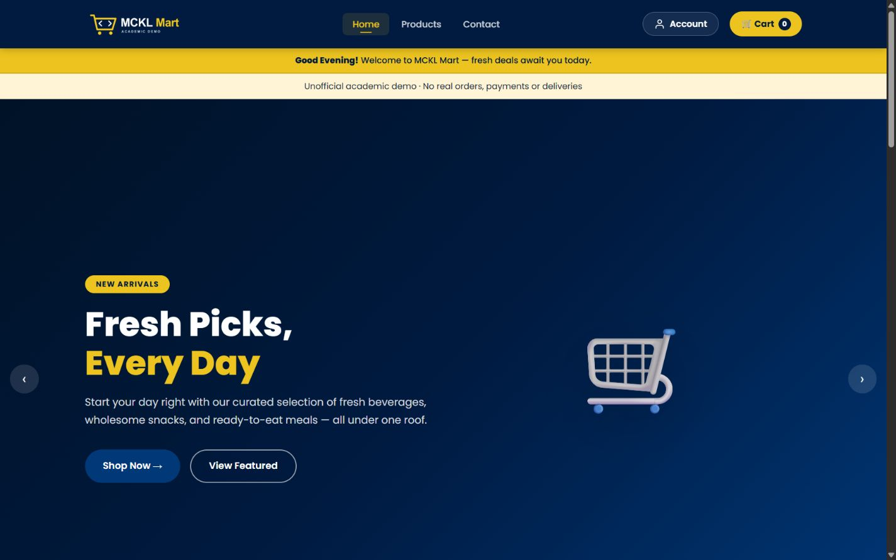
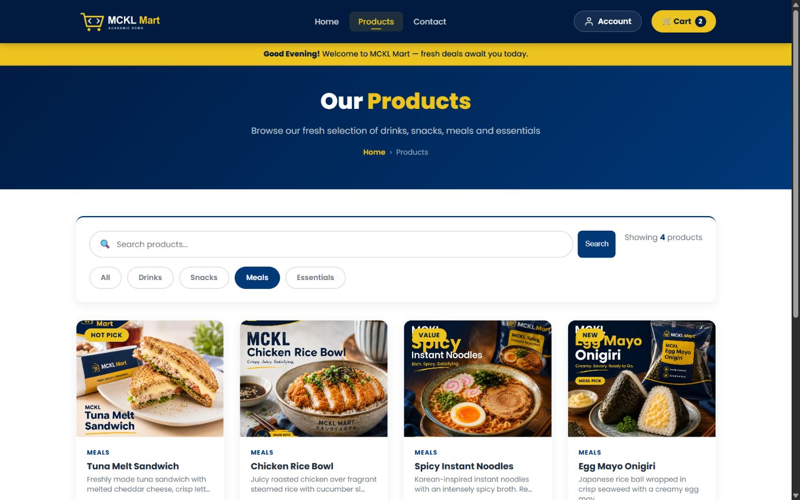
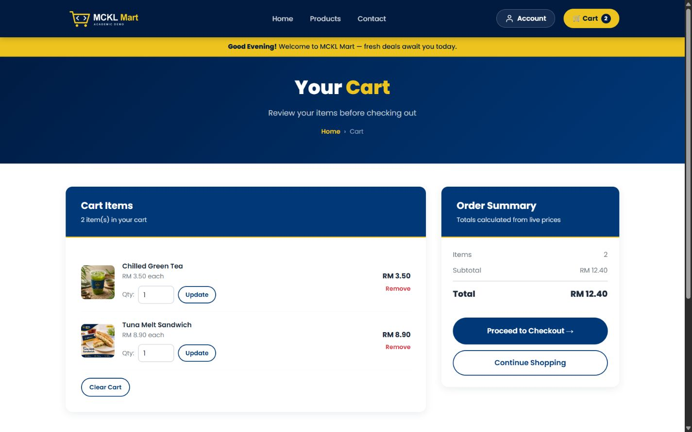
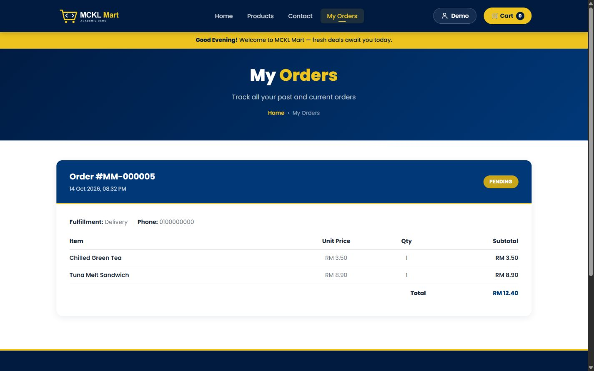
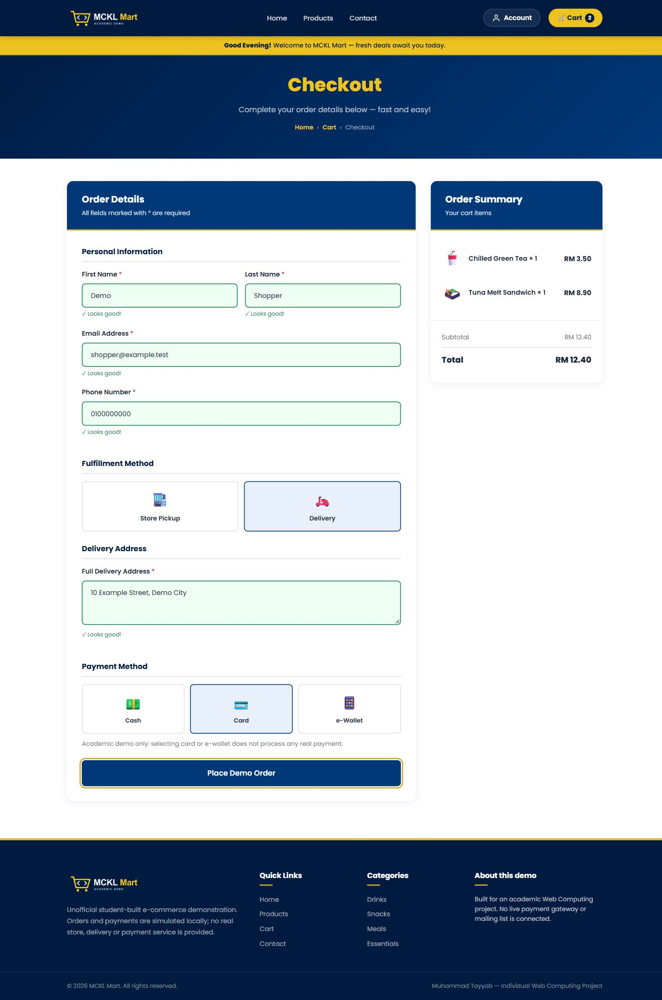
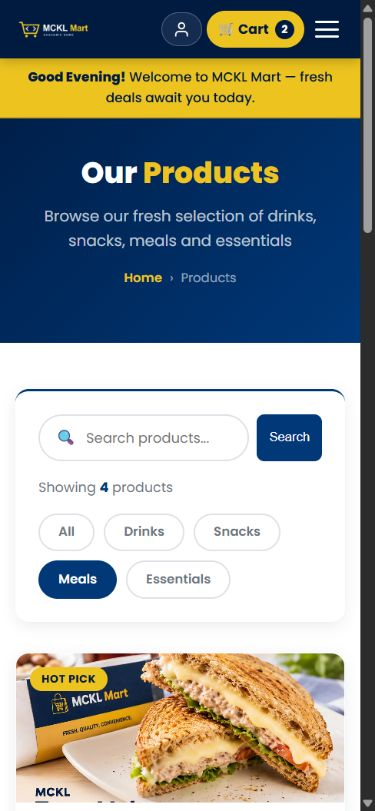
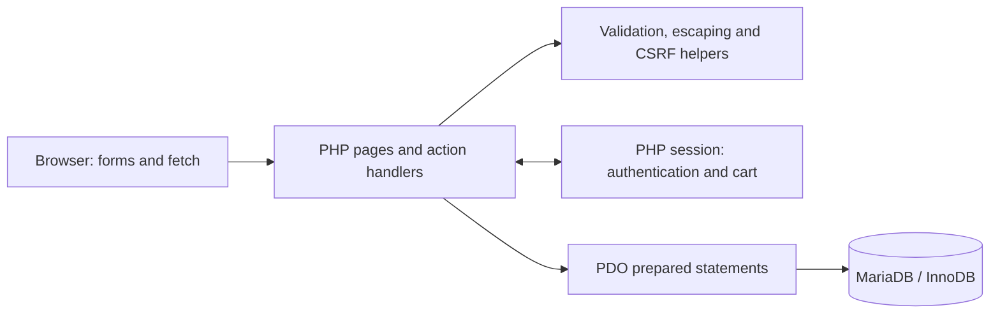
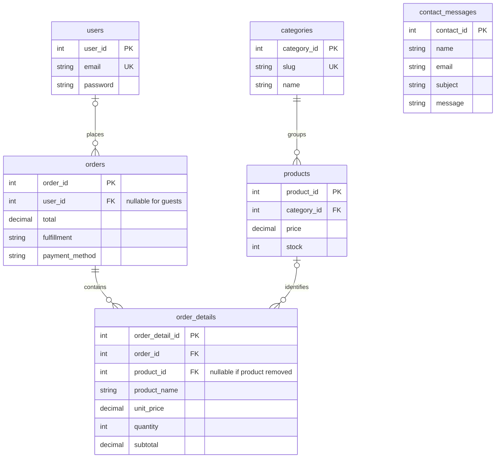

# MCKL Mart
### PHP & MySQL E-Commerce Web Application

**Developed by Muhammad Tayyab** · Individual Diploma in Computer Science Web Computing project

A locally runnable convenience-store application that takes a customer from product discovery to a database-backed demo order. Built with PHP, PDO and MariaDB, it demonstrates authentication, session carts, server-side validation and checkout transactions that protect stock when requests compete.

> **Academic demonstration only.** This project is not operated, sponsored or endorsed by Methodist College Kuala Lumpur. Payments, fulfillment and product packaging are fictional demonstrations. No real charge, delivery or support email is connected.

[Features](#features) · [Architecture](#system-architecture) · [Installation](#installation) · [Testing](#testing) · [Limitations](#known-limitations)

## Screenshot gallery

Actual browser captures of this application, using disposable databases and fictional customer details. Product images were generated by the author using ChatGPT Image Generation for coursework/portfolio use; they are not photographs of real merchandise. See [asset provenance](docs/ASSETS.md) and [capture details](docs/SCREENSHOTS.md).



| Product discovery | Shopping cart |
| --- | --- |
|  |  |
| **Product details** | **Account order history** |
|  |  |

<details>
<summary>Checkout, mobile and tablet views</summary>






</details>

## Project overview

Developed for an individual Web Computing assignment at Methodist College Kuala Lumpur, Malaysia, MCKL Mart models a small student convenience store. The project connects a responsive interface to a six-table relational database without a frontend framework.

The engineering focus is the full request lifecycle: validate submitted fields, authenticate the session, authorize access, query through prepared statements, commit a consistent order and return useful feedback. The repository includes safe sample data and automated checks so another developer can reproduce those workflows locally.

## Features

| Area | Implemented behavior |
| --- | --- |
| Catalogue | 17 sample products in Drinks, Snacks, Meals and Essentials; keyword search, category filters, product pages and stock indicators. |
| Accounts | Registration, hashed passwords, login/logout, session rotation and a shared account panel. |
| Cart | Session-based add, update, remove and clear actions; current-stock checks and a 99-item per-product cap. |
| Checkout | Guest or account ordering; pickup slots or a delivery address; cash, card or e-wallet **selection only**. |
| Order processing | Server-calculated prices, product row locks, conditional inventory deduction, order lines and transaction rollback. |
| Order history | Account-owned orders and details; a guest can link their latest order by registering in the same session with its matching email. |
| Contact | Validated messages saved to the local database with confirmation; no email transmission. |
| Interface | Responsive layouts, keyboard-accessible controls, dialog focus handling, visible focus and a pausable slideshow. |

There is no admin product-management dashboard, payment gateway, courier integration or password-recovery service.

## Technology stack

| Layer | Technology |
| --- | --- |
| Server | PHP 8.2+, PDO MySQL, `mbstring` |
| Database | MariaDB 10.4+ with InnoDB; verified locally on 10.4.32 |
| Browser | HTML5, CSS3, vanilla JavaScript |
| Local hosting | XAMPP / Apache on Windows |
| Verification | PHP CLI and cURL, Node.js, browser checks, GitHub Actions workflow |
| Dependencies | No Composer or npm application dependencies; optional Google Fonts with a system-font fallback |

PDO's MySQL driver is used. MySQL server compatibility has not been independently verified; the tested database engine is MariaDB.

## System architecture



- **Authentication:** registration hashes the password; login verifies it and rotates the session ID. Protected pages filter orders by the authenticated user ID.
- **Cart:** the session stores product IDs and quantities. Display and checkout re-read catalogue prices and availability from MariaDB.
- **Checkout:** validate input, begin a transaction, lock products in ID order, check stock, write the order and its lines, deduct inventory and commit. Any failure rolls back the transaction; successful submission redirects to a confirmation.
- **Configuration:** environment variables or an ignored local PHP file supply the connection. Credentials are never part of the public example.

| Path | Responsibility |
| --- | --- |
| Root PHP pages | Catalogue, accounts, cart, checkout, history and contact |
| `includes/` | Bootstrap, database connection, shared helpers and layout |
| `database/` | Schema and safe catalogue seed |
| `Products/` | Author-supplied AI-generated product illustrations |
| `assets/` | Original project-logo vector source |
| `tests/` | Helpers, static checks, disposable database/HTTP tests and rendered JavaScript parsing |
| `docs/` | Test evidence, repair history, asset provenance and screenshots |
| `.github/workflows/ci.yml` | Linux syntax, helper, static and disposable MariaDB checks |

## Database design



All six tables use InnoDB. Four foreign keys connect catalogue, accounts and orders; contact messages are independent. Order lines retain purchased names and prices. Unique keys protect account emails and category slugs. Fresh imports include nonnegative price/stock and order-line arithmetic constraints. See [database notes](database/README.md).

## Installation

1. Install XAMPP with **PHP 8.2+ and MariaDB**. Place this repository at `C:\xampp\htdocs\MCKL-Mart` and start **Apache** and **MySQL** in XAMPP.
2. Confirm `pdo_mysql` and `mbstring` are enabled in `C:\xampp\php\php.ini`; restart Apache after changes.
3. **For a new installation only**, create an empty database named `mckl_mart_portfolio` with `utf8mb4_unicode_ci` in [phpMyAdmin](http://localhost/phpmyadmin/). Import `database/setup.sql`, or `schema.sql` followed by `seed.sql`. Skip this step for an existing installation; never re-import over coursework or existing customer data.
4. Create `mckl_mart_app` at `localhost` in phpMyAdmin, choosing its password privately. Give it only the storefront permissions:

   ```sql
   -- Create the account privately in phpMyAdmin before granting access.
   GRANT SELECT, INSERT, UPDATE, DELETE
     ON mckl_mart_portfolio.* TO 'mckl_mart_app'@'localhost';
   ```

5. Copy `includes/config.example.php` to `includes/config.local.php` **only if the local file does not already exist**. Replace the password placeholder privately and save. The file must return a PHP array; preserve quoting and escape `'` as `\'` and `\` as `\\` in single-quoted values.
6. Open **[http://localhost/MCKL-Mart/](http://localhost/MCKL-Mart/)**. Register a fictional account or try guest checkout.

The public example contains only `localhost:3306`, the database/account names and a placeholder. Keep the real local configuration off Git. Use the restricted application account, not the database administrator.

Environment alternatives: `MCKL_DB_HOST`, `MCKL_DB_PORT`, `MCKL_DB_NAME`, `MCKL_DB_USER`, `MCKL_DB_PASSWORD`. They must be available to the **Apache process** and take precedence over the local file. Variables in an unrelated terminal do not configure a running Apache service.

| Problem | Check |
| --- | --- |
| “MCKL Mart has not been configured” | Exact local filename, saved password and removal of the placeholder. |
| “The demo database is unavailable” | MariaDB service, host/port, database name, account password and permissions. |
| HTTP 500 after server setup | Apache error log, `mod_rewrite` and permission for `.htaccess` overrides. |
| Missing pictures on Linux | Preserve filename case and spaces; run `tests/static_test.php`. |

## Testing

Local verification on **14 October 2026** executed and passed **116 integration checks, 21 helper checks and 33 static checks**, plus PHP and JavaScript syntax checks. The integration suite imports both database setup paths and exercises concurrent checkout, concurrent registration, authorization, CSRF, validation and failure rollback. These results are local evidence, not a coverage or production-security claim.

```powershell
& C:\xampp\php\php.exe tests/helpers_test.php
& C:\xampp\php\php.exe tests/static_test.php
node --check script.js
```

The integration runner requires an explicitly configured local test administrator. It creates two random test databases, starts loopback PHP servers and drops only the databases it created. **It does not reset the portfolio database.** See [full test commands and evidence](docs/TESTING.md), [publication review](docs/PUBLICATION_REVIEW.md) and the [historical repair report](docs/REPAIR_REPORT.md).

The [GitHub Actions workflow](.github/workflows/ci.yml) has passed local actionlint validation. GitHub-hosted execution and remote rendering are checked during publication; the publication report records the verified result.

## Security features

- Native PDO prepared statements; shared server-side input validation and escaped HTML output.
- `password_hash` / `password_verify`; validation limits bcrypt input to 72 bytes.
- Session-bound CSRF tokens and POST-only cart/logout mutations.
- Dedicated session cookie, strict mode, HttpOnly, SameSite=Lax and HTTPS-dependent Secure; session rotation on authentication.
- Exact local redirect allowlist, owner-restricted history/confirmations and generic browser error responses.
- Transactional checkout with row locking, inventory checks and rollback.
- Apache rules deny private directories, dotfiles, SQL exports, backups and directory listing; personal responses use `Cache-Control: no-store`.

These are implemented and regression-tested controls. No penetration-test certification or production-security guarantee is claimed.

## Known limitations

- Payments and pickup/delivery are simulated; contact messages stay in MariaDB.
- No persistent rate limiting, email verification, password reset, admin dashboard or order-status management UI.
- HTTPS deployment, other database engines, cross-browser/device coverage, accessibility certification and load testing remain unverified.
- Existing installations do not automatically receive the new schema CHECK constraints; a reviewed migration is needed. Do not re-import to upgrade.
- AI product art is fictional. The author confirms generating all 17 images using ChatGPT Image Generation for this assignment; exact model/version and prompts are not recorded. See [asset review](docs/ASSETS.md).
- This is a locally runnable PHP project. GitHub Pages cannot run its PHP/MariaDB backend; no live deployment is claimed.

## Future improvements

Add an authorized admin interface, pagination, rate limiting and account recovery; expand browser/accessibility tests; introduce migrations and deployment monitoring. Real payment or fulfillment integrations would require separate design and verification.

## Author

**Muhammad Tayyab — Individual Web Computing Project**
Diploma in Computer Science · Methodist College Kuala Lumpur, Malaysia
GitHub: [tayyab-hub](https://github.com/tayyab-hub)

The college name identifies the academic context only. No blanket software or artwork license has been added without the author's decision.
